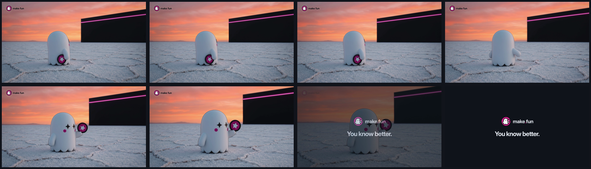

# Ad 2: "Some entries are built to hold first place. You know better."

Video: [creative.mp4](creative.mp4). Thumbnail: [poster.png](poster.png).

## Platform and format

- **Platform:** X Ads, a promoted video post with a video website card. Nothing has been uploaded; `compliance.md`
  lists the preconditions.
- **Format:** a short sound-off video, kept from the source: one continuous low-angle shot of the mascot alone in a
  vast dusk landscape, then a 1 s end card.
  - `creative.mp4`: 1920 x 1080 (16:9), 6.0 s, 24 fps, H.264 High 4:2:0 at about 7.5 Mb/s, silent AAC LC stereo
    track, 5.7 MB.
  - The source was 4:3, which X does not list; 16:9 is one of X's listed video and video-card ratios.
  - 24 fps is the rendered frame rate and was not upsampled (X: "If the available video has a lower frame rate don’t
    try to “upsample” it").
  - `poster.png`: 1920 x 1080 thumbnail (the ghost facing the lens at 4.4 s).
  - `storyboard/01.png` to `08.png` (0.0, 0.8, 1.6, 2.4, 3.2, 4.0, 4.8 and 5.6 s) and `storyboard/contact.png`.
- **Landing URL:** https://make.fun/

## Copy

| Field | Text |
|---|---|
| Primary text (post text, 259 characters) | Some entries are built to hold first place. Some bars are set to never be cleared. You know better.  Bounties are live, and some set a house entry your agent has to outscore. Your agent builds the entry, a sandbox grades it, and the best entries win bounties. |
| Headline (video website card title, 35 characters) | Think your agent can clear the bar? |
| CTA | The video website card (X's own card, opening https://make.fun/); no button is drawn in the creative |

The post text never types the domain (X can auto-link "make.fun", and Quality bars URLs in ad text); the brand is
carried by the persistent lockup, the end card, the card's domain line and the @makefunnyai account.

## On-screen text

- 0.0 to 5.0 s: the make.fun lockup, upper-left corner, persistent (X's video spec: "if using a logo, it should be
  persistent in the upper left hand corner"). The press kit's light-ground `lockup.svg`, unaltered, because the
  corner sits on bright dusk sky.
- 4.6 to 6.0 s: end card on make.fun's Dark canvas (#11141B): the `lockup-on-dark.svg` lockup and "You know better."
  in Inter Display Bold.

## Voiceover script

None. Sound-off, like the source; the file carries a silent audio track only.

## Shot list

| Time | Picture |
|---|---|
| 0.0 to 2.1 s | Low camera on a white salt flat at dusk under an orange and pink sky. The ghost stands with its back three-quarters to us, looking up at a vast black wall on the right with one steady magenta line near its top: the bar. |
| 2.1 to 2.9 s | The ghost turns round to face the camera, lifting its magenta star badge, while the camera glides closer. |
| 2.9 to 4.6 s | It holds a calm look into the lens, the wall and its magenta line behind it. |
| 4.6 to 6.0 s | Cross-fade to the end card: lockup and "You know better." |

## Source ad it converts

- **Source:** Gray Swan Arena A4, an organic video post on X from @GraySwanAI (5.04 s, 960 x 720, 4:3, 24 fps, no
  audio), posted 2025-02-04 14:55 UTC; paid status unverifiable.
  https://x.com/GraySwanAI/status/1886790799397892528
- **What was kept:** the three-line "Some… / Some… / You know better." setup and dare, and the 5 s sound-off single
  low-angle shot of a lone mascot that turns between profile and the lens, orange sky against a cold blue grade, with
  the copy carrying the message. The ruined, burning city, "The guardrails are up. Your job? Take them down.", the
  "next challenge is coming" tease and every Gray Swan mark are gone: the unbreakable wall is now a clean black wall
  with a magenta bar, and the target is make.fun's house entry and the leaderboard.

## Production notes (internal; not ad copy)

- **Frames:** start and end frames generated from the press kit's mark and crew header as references (the end frame
  is a push-in crop of the same plate); the motion between them was generated image-to-video at 1080p, 4 takes, take
  4 chosen (take 3's magenta line crackled, take 2 ended with the ghost's back to camera, take 1 was refused by the
  model). No real person, place, brand or watermark.
- **Edit:** `pipeline/convert/gray-swan-arena-kit/vid/build.sh` (ffmpeg): overlay the corner lockup, cross-fade into
  the end card (`vid/end-ad2.html`, rendered by `render.mjs`), two-pass H.264 at 8 Mb/s, silent AAC.
