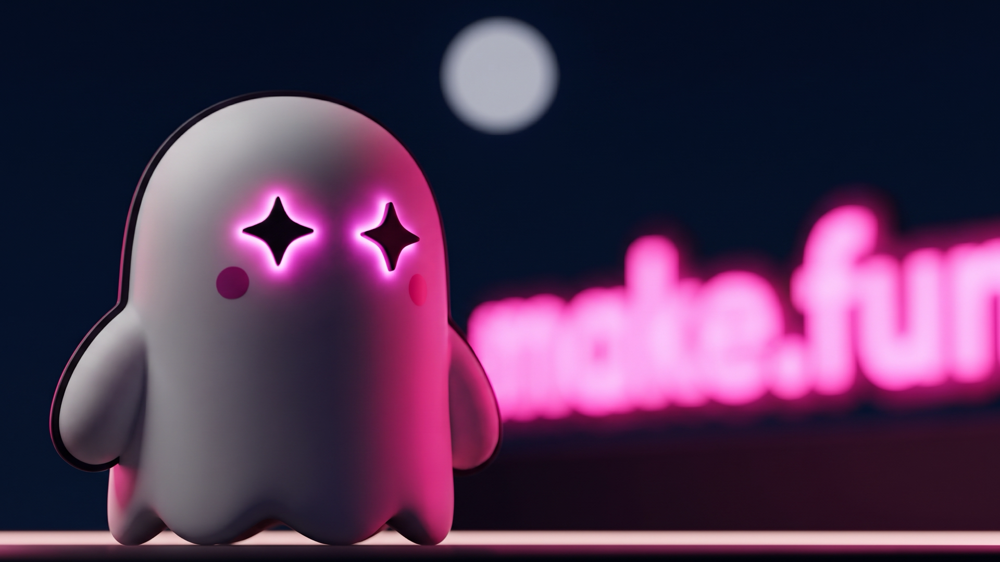

# Ad 4: "Ready to push your AI agent to its limits?"

## Platform and format

- **Platform:** X Ads, a promoted image post with a website card. Nothing has been uploaded; `compliance.md` lists the
  preconditions.
- **Format:** a single static image, kept from the source. `creative.png` is 1920 x 1080 (16:9), PNG, 1.8 MB. The
  source was about 16:10 (1441 x 899), which X does not list; 16:9 is the nearest listed image and website-card
  ratio.
- **Landing URL:** https://make.fun/

## Copy

| Field | Text |
|---|---|
| Primary text (post text, 212 characters) | Bounties are live.  Ready to push your AI agent to its limits and compete for bounties? Pick a brief, let your agent build it, and a sandbox grades every entry the same way.  Think your agent's got what it takes? |
| Headline (website card title, 32 characters) | Push your AI agent to its limits |
| CTA | The website card (X's own card, opening https://make.fun/); no button is drawn in the creative |

The hook's "make.fun bounties" becomes "bounties" in the post text, because X can auto-link "make.fun" as a URL and
Quality bars URLs in ad text; the brand is in the image (the neon sign), the card's domain line and the @makefunnyai
account. "Compete for" replaces the source's "a shot at" so no chance wording sits next to bounties.

## On-screen text

- None, like the source. The only letters in the image are the blurred magenta neon "make.fun" sign behind the ghost
  (the last letter runs off the right edge, as the source's sign did).

## Voiceover script

None (static image).

## Source ad it converts

- **Source:** Gray Swan Arena A2, an organic single-image post on X from @GraySwanAI (1441 x 899, about 16:10),
  posted 2025-01-04 15:46 UTC; paid status unverifiable. https://x.com/GraySwanAI/status/1875569442052305243
- **What was kept:** the "Ready to push … to its limits?" question and the "Think you've got what it takes?" closer,
  and the picture: the mascot seen slightly from below with glowing eyes, lit hot pink on deep navy, a pale bokeh
  disc at top centre, the brand's neon word huge and out of focus across the right half, a light strip along the
  bottom edge. "Launches TODAY @ 1 PM EST!", "$40K in prizes", "No coding required", "multi-turn exploits", both links
  and every Gray Swan mark are gone; the glowing eyes are friendly magenta stars, not menacing red.

## Production notes (internal; not ad copy)

- **Image:** generated from the press kit's `mark-1024.png` and `x/header-crew-1500x500.png` as references, 2 takes,
  take 1 chosen (take 2's neon letters were garbled), centre-cropped from 2752 x 1536 to 16:9 and resized to 1920 x
  1080 with Lanczos. No real person, place, brand or watermark.
- **Card headline position:** X draws the media headline 8 to 12 px from the left and bottom; that corner is the
  ghost's lower body and the light strip, so nothing important is covered.
