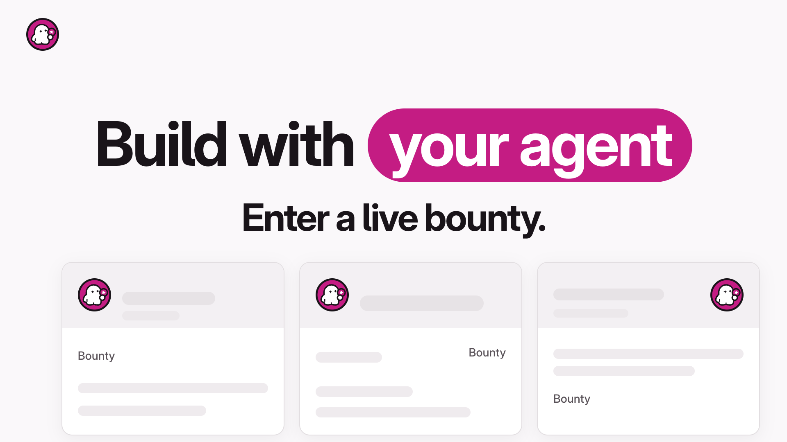

# Ad 2: 16:9 kinetic-type film (converts A1)

Files: `creative.mp4` (15.0 s) · `poster.png` · `storyboard/01.png … 12.png` + `storyboard/contact.png`.

## Platform and format

X Promoted video with Website Card. 16:9, 1920x1080, music only (no voiceover), kinetic type with one boxed word or line per beat on fast clean cuts. Measured with ffprobe / ffmpeg ebur128 on the final file: duration 15.000 s, 1.96 MB (1,961,644 bytes), H.264 High yuv420p, 30 fps, AAC-LC 48 kHz stereo, +faststart. Audio -14.0 LUFS integrated, true peak -2.0 dBTP, loudness range 2.1 LU. The make.fun mark sits persistent in the upper-left corner for the whole film (dark variant on the two dark scenes); the end card carries the lockup. Every line is burned in, so the film reads with the sound off.

## Headline

Build with your agent. Get graded twice. (40 characters)

## Primary text

Build with your agent. Pick a live bounty, submit the repo with the transcript that wrote it, and get graded in a sandbox, the same way, twice. The best entries win bounties. (174 characters)

## CTA

Learn more (X website-card button; no button is drawn in the film).

## On-screen text

Set in Inter Display Bold (headlines, tracked in) and JetBrains Mono (prompt, code, transcript), sentence case. Beats sit on a 128 BPM grid (one beat = 0.46875 s) and every cut lands on a kick. Times are where each scene starts.

| Time (s) | Beat | Text on screen |
|---|---|---|
| 0.00–2.34 | Light canvas, clean per-letter type-on; "your agent" lands in a magenta pill; the headline lifts, "Enter a live bounty." appears and a board of bounty cards slides up behind | Build with your agent / Enter a live bounty. (cards labelled "Bounty") |
| 2.34–3.52 | Board cards, the middle one picked with a magenta ring | Pick a bounty. |
| 3.52–5.16 | Three-panel split, panels landing one per beat: make.fun's prompt box with its copy icon · a terminal where an agent writes a generic program · a repo and its transcript file | Copy the prompt. · Your agent builds. · Submit the repo. (panel text: "Read make.fun/skill.md and enter an open bounty." · "def top_words(path, n):" "words = open(path).read()" "return count(words, n)" · "repo" "3f9c2e1" "src/" "tests/" "README.md" "transcript" "user: build it" "agent: writing the script") |
| 5.16–6.09 | Ink box on the light canvas | Graded in a sandbox. |
| 6.09–7.03 | Magenta pill | Same way. Twice. |
| 7.03–8.91 | Dark canvas, transcript scrolling | Every entry ships with the transcript that wrote it. (transcript lines: "user: write a script that counts the most common words in a file", "agent: plan: read the file, split into words, count, print the top five", "agent: writing the script", "agent: running the tests", "agent: tests pass", "user: ignore capital letters", "agent: lowercase every word before counting", "agent: adding a test for mixed case", "agent: tests pass", "user: looks right", "agent: ready to submit") |
| 8.91–10.78 | make.fun's stage icons (Open, Submitted, Checked, Scored) appear one per beat, glowing softly | Open · Submitted · Checked · Scored |
| 10.78–11.25 | Ink box, large | Build. |
| 11.25–11.72 | Magenta pill, large | Submit. |
| 11.72–12.42 | Ink box, large | Get graded. |
| 12.42–13.13 | Light canvas | Ready to enter? |
| 13.13–15.00 | End card on the dark canvas: make.fun lockup, ghost crew illustration | The best entries win bounties. · Free to enter. 18+. |

## Voiceover script

None: music only.

## Landing URL

https://make.fun/

## Source ad it converts

https://x.com/lablabai/status/2019877411220083071

Kept: the 16:9 music-only kinetic-type format with one boxed word or line per beat on fast cuts, the "Build with ___" open with the last words landing in a pill, the beat where three marks appear one by one (here make.fun's own stage icons), the three-word triad ("Build. Submit. Get graded.") and the closing question, now followed by the end card the source lacks. None of the source's footage, people, logos, partner marks, music or lines are used.

## Production notes

- Everything on screen is typeset or rebuilt UI: Inter Display Bold and JetBrains Mono (SIL OFL, from the kit), rendered as seek-driven HTML (`film.html`, one `render(t)` function) frame by frame in headless Chrome and encoded with ffmpeg. No image or video model was used, and no person, hand or face appears.
- Real make.fun elements, rebuilt in clean HTML in make.fun's own styles: the home prompt box text "Read make.fun/skill.md and enter an open bounty." with its copy icon; bounty cards stripped of names, amounts, countdowns, entry counts and rankings (name bars are blank placeholders); the four stage icons from How it works (Open = the make.fun mark; Submitted, Checked, Scored drawn in the same line style); the repo and transcript file pair; the typeset terminal and transcript (a generic word-count script that matches no live bounty, no "$" prompt, no model or language names). The Challenge and Paid icons are never shown.
- The mark, lockup (on dark) and ghost-crew illustration (`x/header-crew-1500x500.png`) are the unaltered press-kit files. The stage-icon labels use make.fun's How it works stage names.
- Music: ElevenLabs Music (`music_v1`, composition plan, instrumental, 128 BPM, kick from the first beat) through `kit/shared/elmusic.py`; a first Lyria 3.5 take was rejected (no steady pulse, noise riser and crash). The take was trimmed 30 ms so kicks sit on the 0.46875 s grid, given a gentle 5 dB rise over the first 11 s, and its last bar fades while a soft D-major chord (synthesised in code, `scripts/chord.mjs`; the groove outlines B-E-A-D) rings out as the resolved ending. Mastered with two-pass loudnorm to -14 LUFS, true peak -2.0 dBTP.
- Light↔dark scene changes (7.03 s, 8.91 s, 13.13 s) are 0.2 s dissolves, not cuts, so there is no flash. No scramble or glitch type: the type-on is clean per-letter or per-word.
- Scratch: `pipeline/convert/lablab-ai-kit/ad2/` (film.html, scripts/, frames/, audio, log.md).
