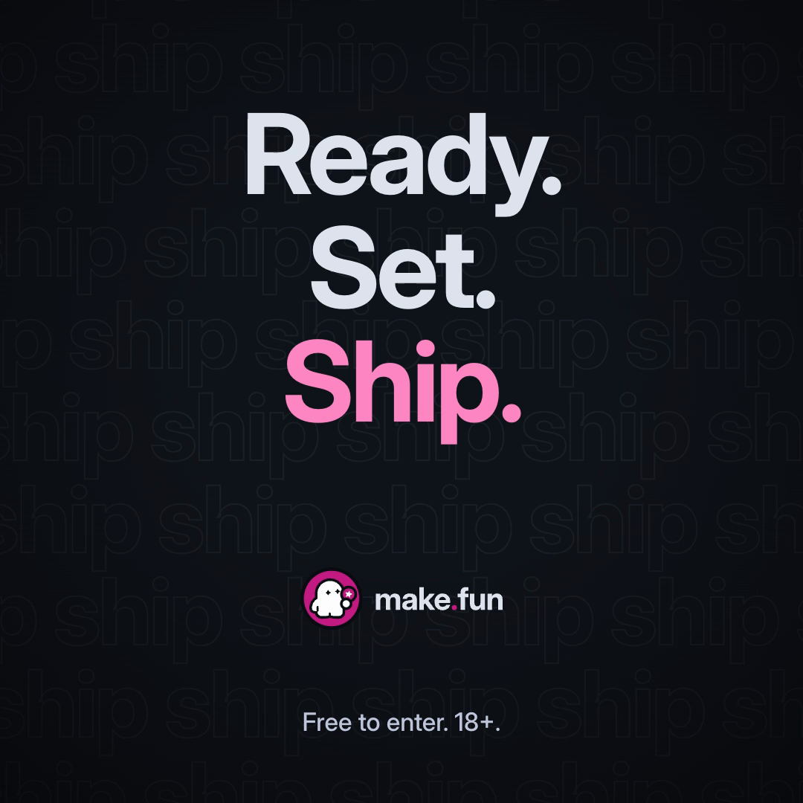

# Ad 4: "Ready. Set. Ship." (step-curve explainer)

Converts WorldQuant's biggest Meta flight (the "next generation of quants" copy, headline "Ready. Set. Quant.", carried by that flight's own three-step rising-curve explainer).

## Platform and format
- X Promoted video with Website Card. Motion-graphics step explainer rendered from one HTML page (`window.seek(t)`, deterministic renderer), 21.2 s.
- `creative.mp4`: 1080x1080 (1:1, primary for X feeds), 30 fps, H.264 High yuv420p, AAC LC 48 kHz stereo, +faststart, 5.6 MB, −14 LUFS integrated (mix.mjs measured −13.98; ffmpeg ebur128 −13.6), true peak −1.8 dBTP.
- `creative-9x16.mp4`: 1080x1920 (9:16, Stories/vertical), same page with a responsive layout, same audio, 21.2 s, 9.0 MB.
- Captions: every spoken line is also a burned-in super (Inter, sentence case). Silent autoplay reads in full.
- `poster.png` 1080x1080; `storyboard/01..10.png` (1:1) and `storyboard/contact.png`.

## Headline
Ready. Set. Ship.

## Primary text
The search for the next generation of agent builders is on. Pick a bounty, build it with your agent, and send the repo with the transcripts that wrote it. Every entry is checked, then graded the same way, twice. The best entries win bounties.

(242 characters, no URL, no hashtag, no emoji.)

## CTA
Learn more

## On-screen text
Both cuts show the same text; timecodes in seconds. Background: Dark canvas #11141B with a soft vignette and a faint outline word-wall of the repeated word "ship" at ~5.5% opacity; make.fun lockup-on-dark small top-left (40 px tall at 1080 wide) from 0 to 16.3 s.

| Time | On screen |
|---|---|
| 0.05–3.6 | "The search for the next generation of **agent builders** is on." (words reveal at the narrator's pace; "agent builders" in magenta #FF88C4) |
| 3.2–12.6 | A magenta (#C41C83) curve draws from bottom-left to top-right through four milestone dots |
| 3.6 | Step 1 · flag icon · "Pick a bounty" |
| 4.8 | Step 2 · terminal icon · "Build it with your agent" |
| 6.5 (+7.95) | Step 3 · commit icon · "Send the repo and the transcripts" (+ "that wrote it") |
| 9.3 | Step 4 · double-check icon · "Every entry, the same way." (9.4) then "Checked," (10.3) "then scored." (11.2) "Twice." (12.7) |
| 10.2–16.3 | make.fun's real entry status card (dark theme, stage list only): Open ✓ · Submitted (current) · Checked · Scored, then at 11.5 Open ✓ · Submitted ✓ · Checked ✓ "All checks passed" · Scored (the flow ends there: no later stage, no title, dates or counts) |
| 13.8–16.3 | "The best entries win bounties." |
| 16.55 / 17.9 / 18.6 | "Ready." / "Set." / "Ship." (stacked, large; "Ship." in magenta) |
| 17.0 | make.fun lockup (centered, 84–112 px tall) |
| 19.0–21.2 | "Free to enter. 18+." |

## Voiceover script
Voice: ElevenLabs premade "Will" (relaxed optimist), speed 1.05. Spoken name never needed. Timecodes from the TTS alignment.
- 0.00 "The search for the next generation of agent builders is on."
- 3.70 "Pick a bounty."
- 4.92 "Build it with your agent."
- 6.61 "Send the repo and the transcripts that wrote it."
- 9.59 "Every entry is checked, then scored the same way, twice."
- 13.97 "The best entries win bounties."
- 16.70 "Ready." · 18.03 "Set." · 18.74 "Ship."

## Landing URL
https://make.fun/

## Source ad it converts
https://www.facebook.com/ads/library/?id=948769810842450 (WorldQuant, Meta flight "The search for the next generation of quants begins…"). Kept: the 9:16 / 1:1 motion-graphics step explainer: a background word-wall of one repeated word, a line rising bottom-left to top-right through milestone dots, each with a small icon and a label easing in, the "next generation" hook and the three-word "Ready. Set. ___." headline. Rewritten: every claim and word (nothing of the source's copy, palette, logo, footage or lines remains; four steps from make.fun's real process; end on Scored).

## Production notes
- Built in HTML/CSS/SVG (one responsive page, `window.seek(t)`) and rendered with the kit's deterministic `render.mjs` at 30 fps for each aspect; audio mixed with `mix.mjs` to −14 LUFS / TP ≤ −1 dBTP.
- Models: ElevenLabs `eleven_multilingual_v2`, voice Will (`bIHbv24MWmeRgasZH58o`), speed 1.05; Google Lyria 3.5 (instrumental, ~100 BPM light electronic, 23 s, no vocals); review via `mcp__media__analyze_media` (gemini-4-argon). No generated footage or images.
- Real UI: make.fun status card re-rendered from `ui/status/card.html` (dark), stage list only; nothing invented.
- Type: Inter Display Bold (opsz 32) headlines, Inter ss04 labels. Lockup: `shared/presskit/lockup-on-dark.svg` as supplied.
- Scratch: `pipeline/convert/worldquant-brain-kit/ad4/` (page/ad.html is the source; render/, audio/, log.md).
